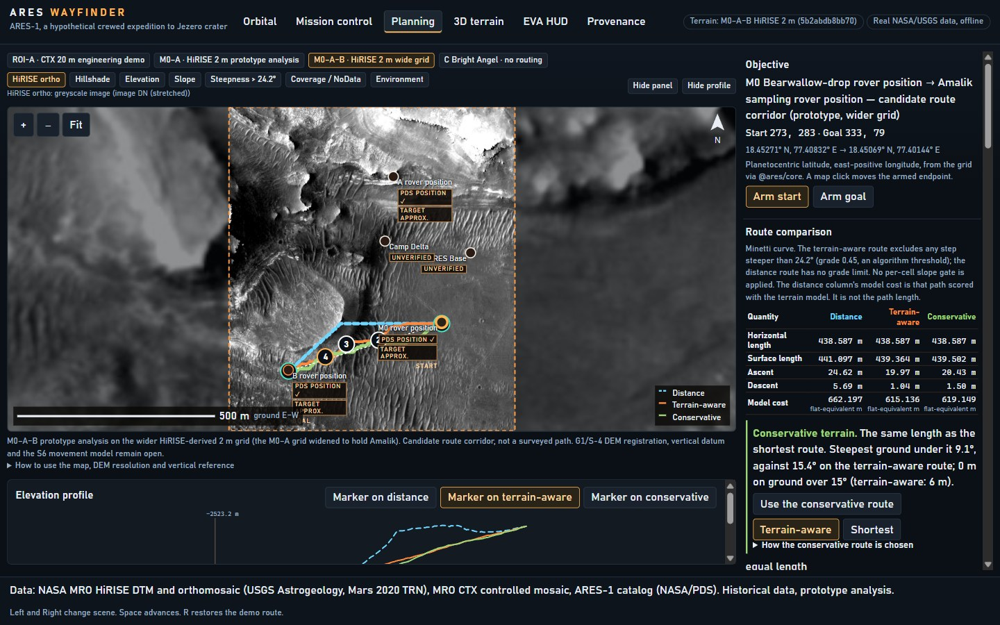
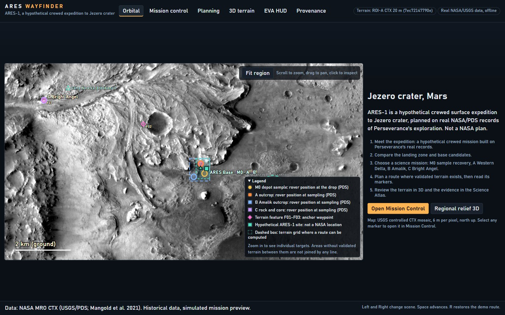
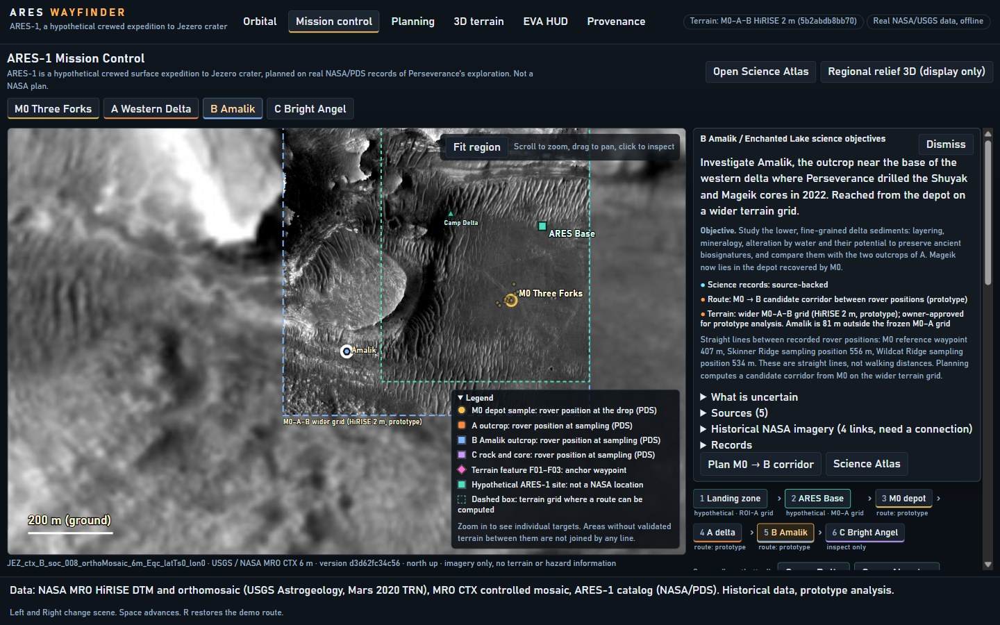
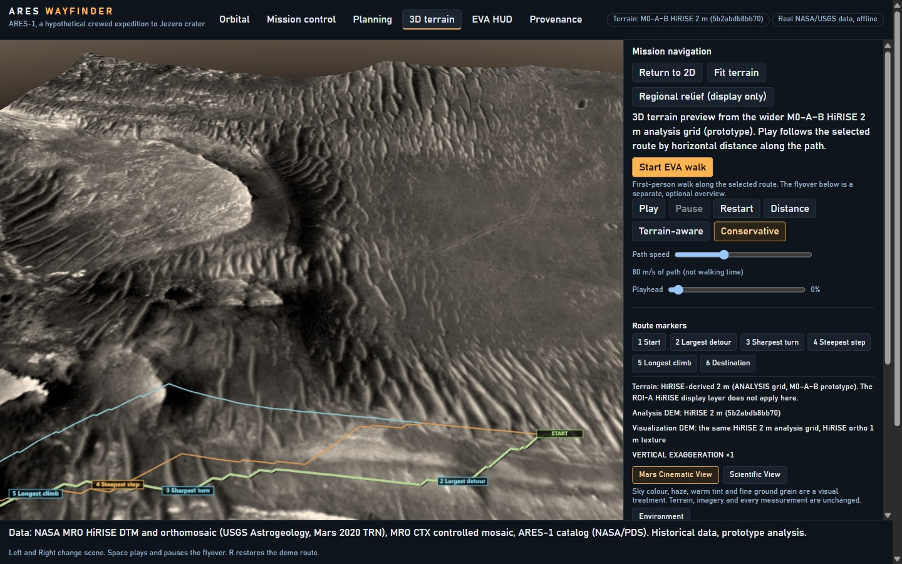
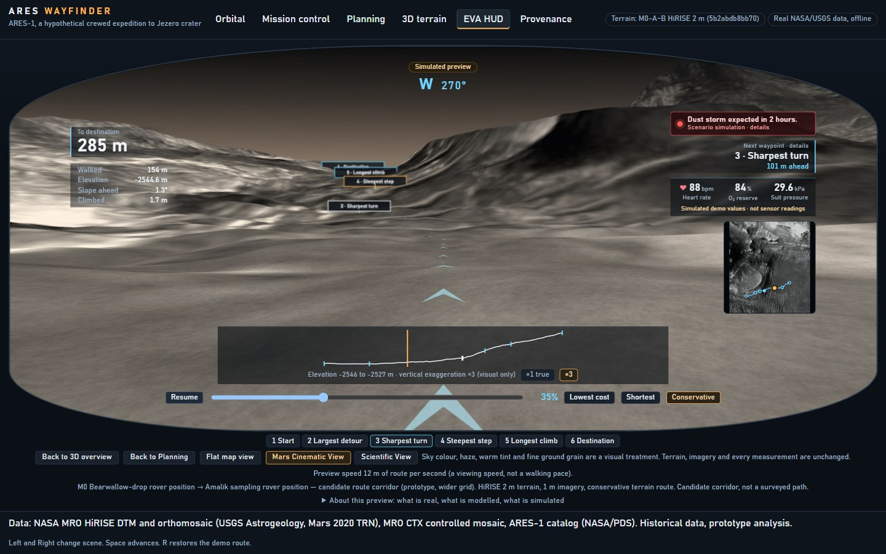
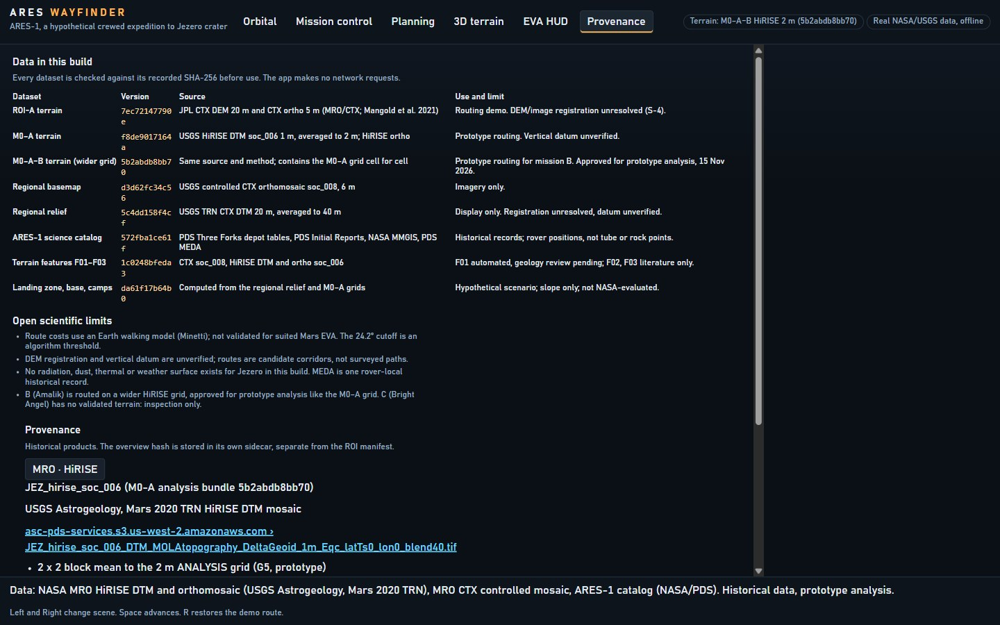

# Ares Wayfinder

NASA Space Apps Challenge 2026 · *Interplanetary Survival Guide: Martian Map* · Konya

**Live demo: https://poyqraz.github.io/** (any desktop browser, no login, no install)

Ares Wayfinder is a "Marswalk" planning prototype for Jezero crater, built on real NASA and USGS
data. It follows **ARES-1, a hypothetical crewed expedition**: it shows where the science targets
are, compares candidate walking routes over real terrain, and previews the walk in 3D and through
a simulated visor. Every layer and number shows its source, resolution and limits. It is a
decision-support demonstration, **not** an EVA safety system.



*Planning scene: three candidate routes from the Three Forks depot to the Amalik outcrop, on a 2 m
grid made from the HiRISE elevation model.*

## Contents

- [Tour of the demo](#tour-of-the-demo)
- [What is real and what is simulated](#what-is-real-and-what-is-simulated)
- [For reviewers](#for-reviewers)
- [Run it locally](#run-it-locally)
- [Run the tests](#run-the-tests)
- [Repository layout](#repository-layout)
- [How the routes are checked](#how-the-routes-are-checked)
- [Data](#data)
- [AI use](#ai-use)
- [License](#license)

## Tour of the demo

Use the buttons at the top of the app, or the Left and Right arrow keys, to move between the six
scenes.

| | |
|---|---|
|  **1. Orbital.** Jezero crater from orbit (MRO CTX) and the analysis areas. |  **2. Mission control.** Four science missions on a regional map, with a read-only Science Atlas built from Mars 2020 PDS records. |
|  **3. Planning.** Three candidate routes on a real elevation grid, with elevation, slope and NoData layers and an explanation of each route. |  **4. 3D terrain.** The same grid and the same routes in 3D, with a labelled vertical exaggeration (×1, ×2.5, ×10). |
|  **5. EVA HUD.** A first-person walk along the selected route, in a simulated visor. |  **6. Provenance.** Every dataset, its version hash, its source and its known limits. |

All pictures are captures of the running app. None is AI-generated.


### Missions

| Mission | Target | In the app |
|---|---|---|
| M0 | Three Forks sample depot | Routed |
| A | Skinner Ridge / Wildcat Ridge (western delta front) | Routed |
| B | Amalik / Enchanted Lake | Routed, on a wider grid |
| C | Bright Angel | Can be inspected; not routed, because there is no analysis grid there yet |

### Routes

| Route | What it does |
|---|---|
| Shortest distance | Minimises length on the grid. |
| Terrain-aware | Minimises a relative terrain cost: step length times a slope factor. |
| Conservative terrain | Keeps away from steep ground and allows for slope uncertainty. If it cannot, it reports "no corridor" instead of relaxing its rule. |

From the depot to Skinner Ridge (mission A), the shortest and terrain-aware routes are both
416.4 m long, and the conservative route is 453.5 m. From the depot to Amalik (mission B), all
three are 438.6 m. Routes are candidate corridors, not surveyed paths.

## What is real and what is simulated

- **Real:** the terrain, imagery, rover positions, sample records and the MEDA pressure series.
  They come from public NASA / USGS / PDS products, and the app checks each data file against a
  SHA-256 manifest when it loads.
- **Hypothetical:** the ARES-1 expedition, its base and its missions. They are a scenario, not a
  NASA plan.
- **Simulated:** the suit indicators in the EVA HUD (heart rate, oxygen, pressure) are fixed demo
  values, not sensor readings. The dust-storm notice is a planned event of the scenario, not a
  weather forecast.
- **Not claimed:** EVA safety, travel time or energy, obstacle clearance, hazard certification,
  weather or radiation maps, life detection. Endpoints are rover positions, not exact rock or
  sample-tube locations. The 24.2° step cutoff is an experimental algorithm setting, not a safety
  limit.

## For reviewers

| Document | Content |
|---|---|
| [Slides (PDF, 7 slides)](docs/submission/ARES_WAYFINDER_SLIDES.pdf) | The submission deck: science rationale, missions, crew, how the system works, limits |
| [Project description](docs/submission/PROJECT_DESCRIPTION.md) | The problem, what we built, how it works, limitations |
| [NASA data and resources](docs/submission/NASA_DATA_AND_RESOURCES.md) | Every NASA / USGS product used, with product IDs, URLs and DOIs |
| [AI use disclosure](docs/submission/AI_USE_DISCLOSURE.md) | Which AI tools were used, for what, and how their output was checked |
| [Demo runbook](docs/submission/DEMO_RUNBOOK.md) | How to run the demo offline |
| [Latest release report](docs/checkpoints/s15-rc1/S15_RC1_REPORT.md) | Test results and evidence for the current build |
| [Documentation map](docs/README.md) | What every folder under `docs/` holds, and which documents are historical |

Lines marked `[TEAM TO CONFIRM]` in the submission documents are still open; they concern team
details such as tool versions and names, not the app.

## Run it locally

Needs Node.js 22 or newer and pnpm. All data ships with the app; it makes no external network
requests.

```bash
pnpm install
```

```bash
pnpm --dir web dev
```

Then open http://localhost:5173. For the production build, use `pnpm --dir web build` and then
`pnpm --dir web preview`.

## Run the tests

| Suite | Command |
|---|---|
| Route core | `pnpm --dir core test` |
| Web unit tests | `pnpm --dir web test` |
| Browser tests (needs `pnpm --dir web exec playwright install chromium` once) | `pnpm --dir web test:e2e` |
| Data pipeline (needs [uv](https://docs.astral.sh/uv/)) | `cd pipeline && uv run pytest` |

## Repository layout

| Path | Content |
|---|---|
| [`contracts/`](contracts/) | Frozen data and interface contract (`CONTRACT.md`, `types.ts`) |
| [`core/`](core/) | Coordinate transforms and the route search (TypeScript, runs in the browser) |
| [`web/`](web/) | The app: Mission Control, planning map, 3D terrain, EVA HUD. The data bundles it loads are in `web/public/data/` |
| [`pipeline/`](pipeline/) | Data preparation, validation gates and an independent Dijkstra oracle (Python) |
| [`ares1/`](ares1/) | The ARES-1 science catalog, built from Mars 2020 PDS records |
| [`analysis/`](analysis/) | Route, sensitivity and coverage analyses with their recorded results |
| [`science/`](science/) | Source register and area validation reports |
| [`docs/`](docs/) | Submission documents, pictures, decisions and release reports ([map](docs/README.md)) |

## How the routes are checked

The route search (A* on an 8-connected grid, no corner cutting, never across NoData) runs in the
browser. A separate Python implementation (Dijkstra, SciPy) is used as an independent oracle, and
the two agree. The data bundles can be rebuilt byte for byte from the public source rasters.

## Data

Mars Reconnaissance Orbiter CTX and HiRISE elevation models and orthomosaics (USGS Astrogeology;
Mangold et al. 2021, doi:10.1126/science.abl4051; Fergason et al. 2020), and Mars 2020 Perseverance
sample, waypoint and MEDA records (NASA PDS). The full list is in
[NASA data and resources](docs/submission/NASA_DATA_AND_RESOURCES.md).

## AI use

AI coding assistants (Claude Code, Cursor) were used for research help, code, tests and
documentation, under human direction and review. Details are in the
[AI use disclosure](docs/submission/AI_USE_DISCLOSURE.md).

## License

Apache-2.0. NASA data credits are listed per source. No NASA logos are used.
