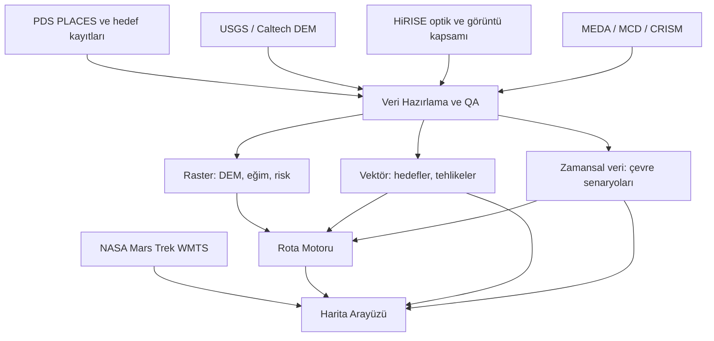

# ARES-1 — Jezero Mars EVA Rota Planlama Sistemi

> **Geliştiriciye teknik devir dokümanı**  
> **Sürüm:** 1.0 · **Hazırlanma tarihi:** 14 Kasım 2026  
> **Durum:** Hackathon prototip tasarımı; gerçek uçuş/astronot güvenliği için sertifikalı değildir.  
> **Eşlik eden dosya:** [`ares1_jezero_hedefler_taslak.geojson`](./ares1_jezero_hedefler_taslak.geojson)

## 0. İlk bakışta: Ne geliştireceğiz?

**Ürün:** NASA/USGS'nin Jezero Krateri verilerini kullanan, astronotun birden fazla bilimsel hedefe hangi yoldan ve hangi koşullarda ulaşabileceğini **açıklanabilir şekilde karşılaştıran** web tabanlı harita/karar destek prototipi.

**Birincil çıktı:** Jezero'nun batısında gerçek uydu görüntüsü üzerinde üç hedef işareti, en az üç *bağımsız veri türü*, yükselti/eğim katmanları ve hedeflere giden alternatif gidiş–dönüş rotaları. İlerleyen aşamada Güneş, meteoroloji, bilimsel değer ve radyasyon senaryoları eklenir.

**Çalışılacak operasyonlar:**

| ID | İş | Konum | Öncelik |
|---|---|---|---|
| M0 | NASA'nın yüzeyde bıraktığı 10 örnek tüpünü geri kazanma (varsayımsal) | **Three Forks Sample Depot** | İlk hedef / A ile birleştirilebilir |
| A | Eski delta tortullarını inceleme, yeni örnekleme | **Batı Delta Cephesi — Wildcat Ridge, Skinner Ridge; bağlam: Hawksbill Gap, Hogwallow Flats** | İlk bilimsel EVA |
| B | Potansiyel biyolojik izlerle ilişkili kayaçları yeniden inceleme, yeni örnekleme | **Neretva Vallis — Bright Angel / Cheyava Falls** | İkinci bilimsel EVA |

**Önemli:** Bunlar üç ayrı *operasyon hedefi*dir; NASA'nın resmî olarak planladığı insanlı görevler değildir. İniş/üs noktası **henüz seçilmedi**. Astronotların Dünya'ya numune götürmesi hikâyenin varsayımsal uzun vadeli hedefidir; uygulamanın kapsadığı konu **Mars yüzeyinde rota ve EVA planlama**dır.

### Ekip içinde sorumluluk ayrımı

- **Veri analizi / QA:** Kaynağı araştırma, koordinat/birim doğrulama, çözünürlük ve kapsama kontrolü, NoData kontrolü, model–ölçüm ayrımını koruma, test raporu.
- **Yazılım geliştirme:** Mars uyumlu harita gösterimi, veriyi kırpma/ön işleme, rota motoru, kullanıcı arayüzü, veri servisleri, test otomasyonu.
- **Ortak karar:** EVA hızı, geçilebilir eğim, engel tamponu, süre/enerji bütçesi ve maliyet ağırlıkları **insanlara özel güvenlik standardı gibi gösterilmeyecek**; prototip varsayımı olarak açıkça tanımlanacak.

---

## 1. Bilimsel dayanak ve görev hikâyesi

### 1.1 Bilimsel gerçekler

- **Jezero Krateri ~45 km çapında** eski bir göl/delta ortamına sahip. Geçmişte Mars'ta sıvı su bulunduğuna dair güçlü jeolojik kanıtlar vardır; açık soru, geçmiş yaşamın varlığıdır. [NASA Jezero iniş yeri açıklaması](https://www.jpl.nasa.gov/news/press_kits/mars_2020/landing/mission/landing_site/) · [NASA Perseverance](https://science.nasa.gov/mission/mars-2020-perseverance/).
- **Perseverance 18 Şubat 2021'de Jezero'ya indi.** Batı deltasında **Wildcat Ridge** ve **Skinner Ridge** kayaçlarından örnekler aldı. Bu iki örnekleme kayaç çıkıntısı birbirinden yaklaşık **20 m** uzaklıkta. [NASA: İki örnekleme noktası](https://science.nasa.gov/resource/two-perseverance-sampling-locations-in-jezeros-delta/).
- **Cheyava Falls**, Neretva Vallis içindeki **Bright Angel** formasyonunda bulunan **bir kaya adıdır; şelale değildir**. Buradan **Sapphire Canyon** karotu 21 Temmuz 2024'te (Sol 1215) mühürlendi. NASA'nın [numune kataloğu](https://science.nasa.gov/mission/mars-2020-perseverance/mars-rock-samples/) örneğin o tarihte gezgin içinde bulunduğunu belirtir; **Three Forks deposunda değildir**.
- Cheyava Falls çalışmaları organik maddeyle ilişkili işaretler ve bazı demir minerali birliktelikleri bildirdi. **Potansiyel biyolojik iz**, yaşamın ispatı **değildir**: biyolojik olmayan açıklamalar da araştırılıyor. [Nature 2025 araştırması](https://www.nature.com/articles/s41586-025-09413-0) · [NASA 10 Eylül 2025 açıklaması](https://www.nasa.gov/news-release/nasa-says-mars-rover-discovered-potential-biosignature-last-year/).
- Three Forks deposundaki **10 tüp 2022 sonu–Ocak 2023 arasında** 5–15 m aralıklarla bırakıldı. Bunlar bilinen mühürlü numuneler ve bir kontaminasyon kontrol tüpünü içerir. Kesin tüp konumları ayrı görev kayıtlarından çıkarılmalıdır. [NASA depo haritası](https://science.nasa.gov/resource/perseverances-three-forks-sample-depot-map/) · [PDS Analyst's Notebook depo kayıtları](https://an.rsl.wustl.edu/help/Content/About%20the%20mission/M20/Return%20sample%20science/Three%20Forks%20Depot.htm).

### 1.2 Varsayımsal insanlı görev

- **Ad:** ARES-1: Echoes of Ancient Mars (geçici ürün/görev adı).
- **Zaman:** Örnek olarak **2040**; NASA tarafından onaylanmış uçuş tarihi değildir.
- **Mürettebat:** **4 astronot**, iki kişilik EVA ekibi. NASA'nın 2025 Moon to Mars mimari güncellemesi başlangıç insanlı Mars yüzey görevleri için **en az 4**, kapasite/risk azaltma için **6'ya kadar** mürettebatı değerlendiriyor. Bu sayı proje senaryosu için tercih edilen konfigürasyondur, kesinleşmiş gerçek Mars seferi değildir. [NASA mimari güncellemesi (s. 12)](https://www.nasa.gov/wp-content/uploads/2025/12/2025-architecture-update-for-publication.pdf).
- **Bilimsel soru:** Jezero deltasındaki ve Bright Angel'daki tortulların/minerallerin gözlenen özellikleri biyolojik veya biyolojik olmayan hangi süreçlerle açıklanabilir? Bu iki ortam su geçmişi açısından nasıl ilişkilidir?
- **Saha operasyonu:** Üs → M0 tüp deposu → dönüş; ayrı EVA ile A delta incelemesi → dönüş; ayrı EVA ile B Bright Angel incelemesi → dönüş. Gerçek rota ve EVA birleştirme kararı veriye göre değişebilir.
- **Örnek dönüşü:** Uzun vadeli senaryoda Dünya laboratuvarına teslim; iniş-kalkış aracı, Mars'tan yükseliş ve Dünya dönüş sistemlerini **uygulama geliştirme kapsamına almayın**. 2026 itibarıyla önceki robotik Mars Sample Return programının statüsü de değişmiştir; varsayımsal görev asla NASA'nın yürürlükteki onaylı dönüş planı diye sunulmamalı. [NASA OIG 2026 raporu](https://oig.nasa.gov/wp-content/uploads/2026/11/2026-report-on-nasas-top-management-and-performance-challenges.pdf).

**Ürünün vaat etmediği şey:** Mars'ta yaşamı kanıtlama, insan taşıyan uzay aracı için güvenli iniş sertifikası verme veya gelecekteki hava/radyasyon olaylarını kesin tahmin etme.

---

## 2. Coğrafi kapsam ve hedef koordinatları

### 2.1 Harita başlangıç çerçevesi

| Özellik | Değer | Anlamı |
|---|---|---|
| Gövde | Mars | Dünya değil |
| Bölge | Jezero'nun batısı, delta–Neretva Vallis | Tüm Mars'ı işlemek gerekmiyor |
| İlk görünüm — batı | **77.28° E** | Uygulama başlangıç bounding box'ı |
| İlk görünüm — doğu | **77.44° E** | Öneri, NASA operasyon sınırı değil |
| İlk görünüm — güney | **18.43° N** | — |
| İlk görünüm — kuzey | **18.52° N** | Üç taslak işareti kapsar |
| Boylam konvansiyonu | **0–360° doğu (+E)** | Bütün dosyalarda açıkça belirt |
| Enlem tipi | Kaynak etiketiyle teyit edilecek | Planetocentric / planetographic ayrımı kritik |

### 2.2 Hazır GeoJSON'daki üç **yaklaşık** referans işareti

Bu koordinatlar NASA'nın **Perseverance waypoint GeoJSON** kayıtlarında doğrulanmıştır: [NASA M20 Waypoints JSON](https://mars.nasa.gov/mmgis-maps/M20/Layers/json/M20_waypoints.json). **NASA rover konumlarıdır; taş/kaya/tüpün santimetre hassasiyetli merkez koordinatları değildir.**

| ID | Harita etiketi | Enlem N | Boylam E | Sol / Rover Motion Counter (RMC) | Statü |
|---|---|---:|---:|---|---|
| M0 | Three Forks — depo bölgesi | **18.45272753** | **77.40833585** | Sol **674**, RMC `32_774` | Yakın rover konumu |
| A | Delta — Wildcat / Skinner çevresi | **18.45869497** | **77.40595178** | Sol **501**, RMC `26_1154` | Temsili rover konumu |
| B | Bright Angel / Cheyava Falls çevresi | **18.49748444** | **77.30519089** | Sol **1210**, RMC `56_0` | Yakın rover konumu; karot **Sol 1215** |

**Mesafeler:** Mars ortalama yarıçapı ~3.389,5 km ile büyük daire hesabı; **güvenli yürüyüş uzunluğu değildir**:

| Çift | Kuş uçuşu |
|---|---:|
| M0 ↔ A | **0,38 km** |
| M0 ↔ B | **6,36 km** |
| A ↔ B | **6,10 km** |

**GeoJSON veri uyarısı:** Standart GeoJSON, RFC 7946 uyarınca Dünya WGS84 tanımını kabul eder. Mevcut dosya, biçimsel olarak bir `FeatureCollection` olsa da içerdiği sayılar **Mars koordinatlarıdır**; bu nedenle standart Dünya GIS istemcilerine *bağlamsız* yüklenmemelidir. Uygulama yalnızca `planet=Mars` ve sabitlenmiş Mars CRS/projeksiyon sözleşmesiyle görüntülemeli. Katmanlar arası dönüşüm açık, test edilebilir olmalı.

### 2.3 Çok önemli ayrımlar

- `M0` **depo bölgesi işaretidir**, tek tek 10 tüpün merkezi **değildir**.
- `A` **delta çevresinin temsili işaretidir**; Wildcat ve Skinner'ın iki ayrı tam örnekleme noktası, Mastcam-Z ve PDS ürünleriyle ayrıca çıkarılacak.
- `B` **Bright Angel civarı rover konumudur**; **Cheyava Falls'un karot noktası** değildir. Sol 1215 örnek kayıtları ve ürün geometrileriyle güncellenecek.
- **Habitat/iniş noktası boş** (`null`/`not_selected`). Geometrik orta noktaya otomatik iniş yerleştirmeyin; jeolojik/topografik değerlendirme yapıldıktan sonra aday belirleyin.
- Daha ayrıntılı arazi/örnek koordinatları doğrulanıncaya kadar UI'da `Yaklaşık konum` etiketi gösterin.

### 2.4 İlgili yer adları ve ilişkileri

- **Jezero Crater:** Ana krater (~45 km çap).
- **Three Forks:** Batı delta cephesinin tabanına yakın sample depot alanı; M0.
- **Delta Front / Western Delta:** Eski göl tortullarının incelendiği bölge; A.
- **Wildcat Ridge, Skinner Ridge:** A için örnekleme hedefleri; birbirine çok yakın.
- **Hawksbill Gap:** Delta cephesine erişim koridoru; **kesin güvenli geçit varsaymayın**.
- **Hogwallow Flats, Enchanted Lake:** Delta cephesindeki diğer Perseverance çalışma noktaları; harita bağlamında gösterilebilir.
- **Belva Crater:** Delta yakınındaki referans krater.
- **Neretva Vallis:** Jezero'ya bağlanan eski nehir vadisi; B'ye giden bölgesel jeolojik ortam.
- **Bright Angel:** Neretva Vallis'te bilimsel formasyon; B.
- **Cheyava Falls:** Bright Angel'da örnek alınmış kaya; B'nin özel araştırma hedefi.
- **Sapphire Canyon:** Cheyava Falls'tan alınmış numune adı; bir yer adı **değil**.
- **Margin Unit / Upper Fan:** İki çalışma bölgesiyle ilişkili jeolojik birimler; potansiyel alternatif ilgi noktaları.

---

## 3. İlk harita uygulaması: NASA Mars Trek WMTS

**Karar:** İlk taban harita için **NASA Mars Trek WMTS**. Uydu haritası başlatmak için çok büyük GIS rasterları indirmek şart değil; harita parçaları servis üzerinden gösterilir. **Rota/eğim hesapları için bu görüntü döşemeleri yeterli değildir; DEM indirmek gereklidir.**

- [Mars Trek uygulaması](https://trek.nasa.gov/mars/)
- [Mars Trek WMTS/API katalog ve kullanım bilgileri](https://trek.nasa.gov/tiles/apidoc/trekAPI.html?body=mars)

**Katalogda doğrulanan Jezero katmanları:**

| İşlev | Layer ID (aynen kullan) | Ölçek/kapsam notu |
|---|---|---|
| Genel çalışma alanı / açılış | `JEZ_ctx_B_soc_008_orthoMosaic_6m_Eqc_latTs0_lon0` | CTX kontrollü mozaik; ~6 m/piksel |
| Yakın plan detay | `JEZ_hirise_soc_006_orthoMosaic_25cm_Eqc_latTs0_lon0_first_dd` | HiRISE kontrollü mozaik; ~0,25 m/piksel |
| Daha geniş bağlam / fallback | `Jezero_CTX_BlockAdj_dd` | Ön taslak CTX kapsamı |
| Tüm Mars / uzak zoom | `Mars_Viking_MDIM21_ClrMosaic_global_232m` | Küresel genel katman |

**Kurulum uyarıları:**

1. İlgili katmanın **WMTS endpoint**, `GetCapabilities`, `TileMatrixSet`, biçim (`.png`/`.jpg`) ve ölçeklerini **katalogdan çalışma anında okuyun**; raster endpoint şablonunu veya TileMatrix indekslerini tahmin etmeyin.
2. Katmanların CRS tanımları farklı görünebilir; örneğin Jezero CTX kaydı Mars 2000 Sphere / equirectangular, bazı genel katmanlar farklı CRS kullanabilir. **Web Mercator EPSG:3857 varsaymayın**.
3. GeoJSON hedeflerini bu harita üzerinde göstermek için enlem/boylam → Mars projeksiyon koordinatları dönüşümünü doğrulayın.
4. Harita lisansı/atıf bilgisi ve veri tarihini katman bilgi panelinde gösterin. Ağ/WMTS bağlantısı olmazsa yerel önizleme veya önceden hazırlanmış NASA görseliyle fallback sunun.
5. Aynı görselin üzerinde koordinatlara göre **tüp etiketleri** gösterirken ilgili tüp koordinatı doğrulanmamışsa depo merkezini tek pin olarak gösterin.

### Kontrol için NASA haritaları (UI tasarım ve doğruluk referansı)

| Görsel / harita | Kullanım amacı | Bağlantı |
|---|---|---|
| Jezero genel/iniş bağlamı | Kraterin yaklaşık 45 km ölçeğini ve delta coğrafyasını öğrenme | [NASA Jezero landing site](https://www.jpl.nasa.gov/news/press_kits/mars_2020/landing/mission/landing_site/) |
| Delta cephesi, Hawksbill Gap, Hogwallow Flats | A bölgesi bağlamı ve eski gezgin güzergâhı | [NASA: Exploring the Front of the Delta](https://science.nasa.gov/resource/perseverance-exploring-the-front-of-the-delta/) |
| Wildcat Ridge / Skinner Ridge | İki örnekleme noktasını görsel doğrulama | [NASA: Two Sampling Locations](https://science.nasa.gov/resource/two-perseverance-sampling-locations-in-jezeros-delta/) |
| Depodaki 10 tüpün şeması | M0 tüp isimleri ve aralarındaki 5–15 m | [NASA: Three Forks Depot Map](https://science.nasa.gov/resource/perseverances-three-forks-sample-depot-map/) |
| Gezginin gerçek geçmiş güzergâhı | Topografik rota ile rover rotasını **karıştırmadan** karşılaştırma | [Perseverance interactive location map](https://science.nasa.gov/mission/mars-2020-perseverance/location-map/) |
| Neretva Vallis → Bright Angel | B bölgesi ve kanalın izlenen güzergâhı | [JPL: Path to Bright Angel](https://www.jpl.nasa.gov/images/pia26334-perseverances-path-to-bright-angel-in-mars-jezero-crater/) |
| Bright Angel panoraması | Astronotun göreceği örnek saha yüzeyi | [NASA: Bright Angel panorama](https://science.nasa.gov/resource/perseverance-captures-bright-angel-in-360-degrees/) |
| Jezero tehlike haritası | İniş tehlikesine ilişkin **robotik** bağlam, insan inişi sertifikası değil | [JPL: Jezero Hazard Map](https://www.jpl.nasa.gov/images/pia24167-jezeros-hazard-map/) |


*Şekil: Tüplerin NASA tarafından belgelenmiş göreli dizilişi. Bu görsel tek başına GIS koordinat dosyası değildir; kesin tüp koordinatları ayrı tüp kayıtlarından türetilmelidir.*

---

## 4. Kaynak envanteri ve entegrasyon önceliği

**En kritik ilke:** Önce **rota hesaplamanın bağımlılıklarını**, sonra zaman bağımlı koşulları ekleyin. Bir parametrenin hayati olması, yazılımda ilk geliştirilecek modül olduğu anlamına gelmez. **Astronot güvenliği açısından hiçbir ölçülmemiş koşul güvenli ilan edilemez.**

### P0 — Temel harita + koordinat + topografya + ilk rota

| Veri / sistem | Kaynak (resmî bağlantı) | Sağladığı şey | Önerilen kullanım / çıktı |
|---|---|---|---|
| NASA Mars Trek | [WMTS API](https://trek.nasa.gov/tiles/apidoc/trekAPI.html?body=mars) | CTX/HiRISE görüntü karoları | UI taban haritası |
| NASA M20 Waypoints | [Rover waypoint JSON](https://mars.nasa.gov/mmgis-maps/M20/Layers/json/M20_waypoints.json) | Enlem, boylam, sol, RMC, rover konumu | Ön gösterim pinleri; referans/QA |
| PDS Rover PLACES | [Mars 2020 PLACES](https://pds-geosciences.wustl.edu/missions/mars2020/places.htm) | Ayrıntılı konum ve poz bilgileri | Hassas hedef konumu doğrulaması |
| USGS 2025 Jezero HiRISE | [Resmî veri yayını, DOI 10.5066/P13CPYYU](https://www.usgs.gov/data/mars-sample-return-hirise-mosaics-terrain-relative-navigation) | Yüksek çözünürlüklü DEM ve ortogörüntüler; Jezero'nun batısını genişleten ürünler | `elevation.tif`, alt bölge kesimi |
| Caltech Murray Lab | [Jezero Channel/Fan DEM](https://murray-lab.caltech.edu/Mars2020/index.html) | Western channel/fan ~**1 m/piksel** DEM; 582 MB ZIP | Alternatif/ek DEM; kapsama doğrulaması |
| HiRISE arşivi | [HiRISE](https://hirise.lpl.arizona.edu/) · [HiRISE DTM](https://hirise.lpl.arizona.edu/dtm/) | Optik görünüm, stereo arazi modelleri | Engeller, görünür kayaçlar |
| MOLA / MGS | [PDS MOLA MEGDR](https://pds-geosciences.wustl.edu/missions/mgs/megdr.html) | Küresel daha kaba yükselti | Krater bağlamı / büyük ölçekli profil; **mikro-engel tespiti için kullanma** |
| PDS Mars ODE | [Orbital Data Explorer](https://ode.rsl.wustl.edu/mars/) | CTX, HiRISE, CRISM, THEMIS vb. veri arama | Veri kapsamı ve ürün arşivi |

**Kritik seçim:** Caltech 1 m/px Channel/Fan DEM'i **M0, A ve B'yi kapsıyor mu diye test edin**. Kapsam dışındaki B için ihtiyaç halinde USGS'nin genişletilmiş ürünlerine geçin. Sırf çözünürlüğü yüksek diye boş kapsama alanını doldurmayın. 0,25 m/px optik çözünürlük = 0,25 m'lik güvenilir yükseklik modeli anlamına gelmez.

### P1 — Üçüncü bağımsız veri türü + bilimsel görev bağlamı

NASA challenge metni en az üç veri türünü **değerlendirmeyi öneriyor**; ekip bunu kendi MVP kalite hedefi olarak kabul ediyor. **DEM ve DEM'den hesaplanan eğim aynı kaynak/tür sayılır**. Önerilen kombinasyon: **(1) optik, (2) topografik, (3) atmosferik veya spektral/kimyasal**.

| Veri | Bağlantı | İçerik | Dikkat |
|---|---|---|---|
| Perseverance MEDA | [PDS MEDA](https://pdsatmospheres.nmsu.edu/data_and_services/atmospheres_data/PERSEVERANCE/meda.html) | ATS hava sıcaklığı, PS basınç, WIND, TIRS yüzey termali, RDS ışınım/toz, RHS nem, ANC güneş geometrisi | **Gezginin bulunduğu yerde ve zamanda ölçülmüştür**, Jezero'nun her metresinde anlık değer değildir |
| Mars Climate Database 6.2 | [MCD web arayüzü](https://www-mars.lmd.jussieu.fr/mcd_python/) · [kullanım ve sınırlamalar](https://www-mars.lmd.jussieu.fr/mars/access.html) | Konum/mevsim/saat/toz senaryosuna göre model basınç, sıcaklık, rüzgâr vb. | **İklim modeli**, 2040 için kesin hava tahmini değil |
| CRISM / MRO | [PDS ODE harita araması](https://ode.rsl.wustl.edu/mars/map/ode_map.aspx) | Spektral/mineral gözlemleri | Seçili hedeflerde **footprint** ve çözünürlük doğrulaması şart |
| Mars 2020 bilim arşivleri | [PDS Mars2020](https://pds-geosciences.wustl.edu/missions/mars2020/) · [PIXL](https://pds-geosciences.wustl.edu/missions/mars2020/pixl.htm) | Kayaç kimyası, görüntü, saha ölçümleri | Çoğu ölçüm **noktasal**; sürekli mineral haritasıymış gibi boyama |
| Tüp ve numune kayıtları | [Three Forks depo](https://an.rsl.wustl.edu/help/Content/About%20the%20mission/M20/Return%20sample%20science/Three%20Forks%20Depot.htm) · [NASA numune kataloğu](https://science.nasa.gov/mission/mars-2020-perseverance/mars-rock-samples/) | Tüp adı, numune kimliği, sol, içerik | Sapphire Canyon deposunda değildir |

**MVP önerisi:** Önce üçüncü tür olarak **MEDA'dan küçük ve gerçek tarihli veri serisi** (örneğin bir veya birkaç sol için sıcaklık/basınç) gösterin; CRISM + jeokimya verisini bilimsel hedef puanlaması için sonra ekleyin. Geçmiş MEDA ölçümlerinin varsayımsal 2040 EVA anlık koşulu olmadığını etiketleyin.

### P2 — Güneş, gölge, fırtına ve ileri fizik

| Veri | Bağlantı | Kullanım | Sınırlama |
|---|---|---|---|
| Mars24 | [NASA Mars24 algoritması](https://www.giss.nasa.gov/tools/mars24/help/algorithm.html) | Güneş yüksekliği/azimutu, yerel Mars saati ve mevsimi (`Ls`) | Enlem türü ve boylam işareti doğru olmalı |
| SPICE / NAIF | [NASA SPICE](https://naif.jpl.nasa.gov/naif/) · [kernel arşivi](https://naif.jpl.nasa.gov/naif/data) | Gelişmiş zaman/gözlem geometrisi | Daha fazla uygulama yükü; opsiyonel |
| MARCI / MRO | [USGS günlük global Mars haritaları](https://astrogeology.usgs.gov/search/map/mars_mro_marci_daily_global_weather_maps_pds4_archive) | Geçmiş toz bulutları ve büyük fırtınalar | Geniş ölçekli, ~0,05–0,1 derece; her patikaya piksel düzeyinde fırtına atama |
| MCS / MRO | [PDS MCS](https://pdsatmospheres.nmsu.edu/data_and_services/atmospheres_data/MARS/aerosols.html) | Atmosfer sıcaklık/toz profilleri | Zamansal/uzamsal kapsam sınırlı |
| THEMIS / Mars Odyssey | [THEMIS Explorer](https://themis-data.asu.edu/viewer/themis) | Gündüz/gece termal IR, bazı termal özellikler | **Yüzey termal görüntüsü**, gerçek zamanlı hava sıcaklığı değil |
| Curiosity RAD | [NASA RAD dozimetri veri seti](https://data.nasa.gov/dataset/mars-science-laboratory-msl-radiation-assessment-detector-rad-level-2-observation-dosimetr-e2695) | Mars yüzeyi iyonlaştırıcı radyasyon referansı | **Gale Krateri**, Jezero ölçümü değil |
| MAVEN SEP | [PDS MAVEN SEP](https://pds.nasa.gov/ds-view/pds/viewBundle.jsp?identifier=urn%3Anasa%3Apds%3Amaven.sep.calibrated&version=2.20) | Güneş enerjik parçacık olayları | **Yörünge ölçümleri**, yüzey astronaut dozu doğrudan çıkarılamaz |

**Bilimsel uyarı:** Güneşin ufuk açısı **UV/görüş/aydınlanma** ile bağlantılıdır; **galaktik kozmik ışınların / güneş parçacıklarının astronot dozuyla eşit değildir**. MEDA **RDS** de astronot dozimetresi değildir. Radyasyon için MVP'de “tarihsel referans + temsili güneş olayında EVA ertelenir” senaryosu kullanılabilir; sahte µSv/h değerleri üretilmemeli.

---

## 5. Uygulama bileşenleri ve veri akışı



**Önerilen teknik dizin** (dil/çatı ekibin tercihidir; zorunlu değil):

```text
ARES-1/
  README.md
  data/
    sources.json                   # Her kaynağın künyesi/sürümü/lisansı
    raw/                           # Kaynaktan gelen orijinal dosyalar; git'e koymak zorunda değiliz
    processed/
      elevation.tif
      slope_deg.tif
      roughness_m.tif
      hazard_mask.tif
      science_targets.geojson
      mission_targets.geojson
      weather_scenarios.csv
    outputs/
      candidate_routes.geojson
      route_metrics.json
      qa_report.csv
  src/
    map/                           # WMTS + Mars CRS + katman kontrolü
    ingest/                        # Raster / tablo ön işleme
    routing/                       # Grid/graph + maliyet
    api/                           # Veri sunum servisleri
  tests/
    geo_alignment/
    terrain/
    routing/
    provenance/
```

### 5.1 Girdi/çıktı formatları

| Veri sınıfı | Önerilen biçim | Kullanım |
|---|---|---|
| Ortogörüntü tabanı | WMTS raster karoları / gerekirse lokal TIF | Görsel harita |
| DEM, eğim, pürüzlülük, risk maskesi | **GeoTIFF** (Mars CRS metadatası ile) | Raster analiz / rota |
| Hedefler, engel poligonları, aday üs alanları | **GeoJSON** veya Mars CRS'li uygun vektör GIS biçimi | Pin/çizgi/poligon |
| Zaman serisi / meteoroloji | **CSV** veya JSON | Sol/saat koşulları |
| Rota çıktısı | **GeoJSON LineString** + metrik JSON | Gösterim ve karşılaştırma |
| Kaynak/güvenilirlik meta verisi | **JSON/CSV** | QA, atıf, veri kökeni |

### 5.2 Temel veri sözleşmesi — `science_targets.geojson`

**Not:** Aşağıdaki örnek **şemayı** gösterir; gerçek kayaç koordinatı değildir. Mevcut taslak dosyayı güvenilirlik bilgisi korunarak kullanın.

```json
{
  "type": "Feature",
  "properties": {
    "id": "B",
    "label": "Bright Angel / Cheyava Falls bölgesi",
    "planet": "Mars",
    "coordinate_status": "approximate_rover_waypoint",
    "source_url": "https://mars.nasa.gov/mmgis-maps/M20/Layers/json/M20_waypoints.json",
    "source_sol": 1210,
    "rover_rmc": "56_0",
    "mission_type": "science_sampling",
    "science_context_url": "https://www.nature.com/articles/s41586-025-09413-0",
    "validated_exact_sample_location": false
  },
  "geometry": {
    "type": "Point",
    "coordinates": [77.30519089, 18.49748444]
  }
}
```

**Örnek seri sözleşmesi — `weather_scenarios.csv`:**

```csv
scenario_id,planet,lat_deg,lon_e_deg,sol,local_solar_time,temperature_K,pressure_Pa,wind_m_s,dust_opacity,data_kind,source_url
example_observed,Mars,18.45,77.40,,,,,,,observed,https://pdsatmospheres.nmsu.edu/data_and_services/atmospheres_data/PERSEVERANCE/meda.html
```

*Yukarıdaki CSV sayısal hava verisi sunmuyor; sadece kolon taslağı. Belirsiz/eksik değerler uydurulmayacak; boş kalacak veya `null` olacak. Kaynak verinin zaman ve koordinatı aynı değilse gerçek değerler kayıtlı zamanında tutulacak.*

### 5.3 Kaynak kataloğu (`sources.json`) minimum alanlar

```json
{
  "source_id": "usgs_jezero_dem_2025",
  "provider": "USGS",
  "mission_instrument": "MRO / HiRISE",
  "url": "https://www.usgs.gov/data/mars-sample-return-hirise-mosaics-terrain-relative-navigation",
  "product_id_or_doi": "10.5066/P13CPYYU",
  "version": null,
  "retrieved_utc": null,
  "native_crs_wkt": null,
  "longitude_direction": "east",
  "latitude_type": "verify_metadata",
  "horizontal_resolution_m": null,
  "vertical_datum": "verify_metadata",
  "units": "verify_metadata",
  "coverage_bbox": null,
  "processing_steps": [],
  "qa_status": "not_evaluated",
  "usage_credit": "USGS/NASA"
}
```

---

## 6. Rota motorunun minimum matematiksel/algoritmik sözleşmesi

### 6.1 Arazi işlem hattı

1. **Tek Mars referans sistemi** belirle: seçilen DEM'in metadata'sını incele; harita, rover pinleri ve diğer rasterları buna dönüştür. **Planetocentric ↔ planetographic** dönüşümünü gerekirse açık uygula.
2. M0, A, B ve olası üs adaylarını kapsayan **çalışma alanı ROI** oluştur; rasterları ROI'ye kırp. Kaynağın kapsamadığı yerler **NoData** olarak kalmalı.
3. DEM'de düşey datum, `NoData`, birim (m), raster piksel boyutu ve kaynak tutarlılığını kontrol et.
4. Eğim için yerel metrik koordinatlarda `dz/dx`, `dz/dy` hesapla; eğim = `atan(sqrt((dz/dx)^2 + (dz/dy)^2))` (radyanı dereceye dönüştür). **Enlem/boylam derecelerini metre gibi kullanma.**
5. İsteğe bağlı pürüzlülük = tanımlı pencere içindeki yükselti varyasyonu veya standart sapması; pencere boyutu ve türetilen ölçümün fiziksel anlamı kayıtlı olmalı.
6. Optik görüntülerden elle doğrulanmış ve/veya işlenmiş kayalık/kumlu alanları **risk maskesi** olarak ekle. Yalnızca DEM, küçük engellerin tamamını yakalayamaz.
7. Kısıtlara göre geçilemeyen hücreleri işaretle. **NoData = güvenli** değildir; rota bunları otomatik geçmemelidir.
8. Grid/graph üzerinde **A\*, Dijkstra** veya uygun maliyetli rota aramasıyla alternatif yollar çıkar.
9. Gidiş ve dönüş ayrı hesaplanmalı; rota geometrisi, uzunluğu ve kümülatif yükselme/alçalma raporlanmalı.

### 6.2 Kısıt ve maliyet sırası

**Önce geçerlilik/güvenlik kapıları, sonra optimizasyon.** Yüksek bilimsel puan, kesin engeli veya görev iptali koşulunu geçersiz kılamaz.

```text
HARD CONSTRAINTS
- çalışma alanı ve veri kapsamı içinde kal
- NoData / analiz edilemeyen kritik hücrelerden kaçın
- tanımlanan eğim/engel sınırını aşma
- belirlenen EVA süre ve dönüş rezervini aşma
- örnek koruma / erişim kısıtlarını ihlal etme
- “EVA iptal” çevresel senaryosunda rota planını bloke et

SOFT COST (yalnızca geçerli yollar arasında)
- yol uzunluğu
- yükselme / alçalma
- eğim ve pürüzlülük kaynaklı hareket maliyeti
- belirlenen çalışma zamanında gölge / görüş koşulları
- bilimsel hedef değeri
- belirsizlik / veri kalitesi cezası
```

**Ağırlıklar ve sınırlar:** Prototip konfigürasyonunda görünür ve değiştirilebilir olsun; **NASA onaylı “astronot geçiş sınırı” gibi sunulmasın**. Başlangıçta güvenlik dışı istatistikleri hesaplayıp göstermemiz yeterlidir. Gerçek astronot fizyolojisi, basınçlı giysi kısıtları ve enerji bütçesi ölçülmeden otomatik “safe” etiketini kullanmayın. Güneş açısı ile iyonlaştırıcı doz birbirine bağlanmamalı.

### 6.3 Minimum rota çıktısı

```json
{
  "route_id": "M0_to_A_candidate_01",
  "status": "prototype_candidate_not_certified",
  "from_target": "M0",
  "to_target": "A",
  "distance_m": null,
  "elevation_gain_m": null,
  "elevation_loss_m": null,
  "maximum_slope_deg": null,
  "mean_slope_deg": null,
  "estimated_travel_time_min": null,
  "no_data_crossed": false,
  "conditions_scenario_id": null,
  "risk_flags": [],
  "data_source_ids": ["usgs_jezero_dem_2025"],
  "calculation_assumptions": [],
  "geometry": {"type": "LineString", "coordinates": []}
}
```

**Koordinat hassasiyeti/mesafe:** Kuş uçuşu Mars yüzeyi mesafesi için Dünya'nın Haversine sabitini kopyalama; Mars yarıçapı/uygun elipsoid üzerinde hesapla. Yol uzunluğu rasterın yerel **metrik** projeksiyonundaki gerçek çizgi uzunluğuyla hesaplanmalı. Yolun metre cinsinden uzunluğu, görüntüde çizilen piksel sayısı değildir.

---

## 7. Ekran/UX gereksinimleri

### Minimum sürüm

- **Harita:** Mars Trek Jezero CTX açılış katmanı; kullanıcı yakınlaştırınca HiRISE; temel ölçek ve kuzey göstergesi.
- **Hedef pinleri:** M0, A, B; açıklama, bilimsel hedef, koordinat, kaynağın URL'si ve `Yaklaşık` etiketi.
- **Katman seçici:** Optik görüntü, DEM yükseklik rengi, eğim, veri kapsama/NoData, engel/risk; üçüncü veri türü için MEDA grafik paneli veya CRISM katmanı.
- **Rota karşılaştırması:** Aynı iki nokta arasında en az iki alternatif aday; mesafe, eğim, toplam yükselme/alçalma ve risk işaretleri.
- **Kaynak paneli:** Açık olan her katmanın misyonu, kaynağı, çözünürlüğü, veri tarihi, model/ölçüm durumu.
- **Uyarı:** “Araştırma prototipi — operasyonel astronot navigasyonu için onaylı değil.”

### Ek geliştirmeler

- EVA günü / yerel güneş saati seçimi → Güneş yükselme/azimut ve DEM'e göre gölge haritası.
- MEDA geçmiş gözlemleri ve MCD model senaryolarının **ayrı renk/etiketlerle** gösterimi.
- CRISM footprint veya konuma bağlı kayaç ölçümleri + bilimsel hedef öncelikleri.
- Radyasyon için olay senaryosu ve **EVA go/no-go**, gerçek doz gösterildiği izlenimini vermeden.
- Üs/iniş adayı seçici: değerlendirme gerektirir; ortalama nokta = güvenli iniş yeri değildir.
- İndirme: rota GeoJSON + metrik JSON + kaynak/QA raporu.

---

## 8. Adım adım entegrasyon ve teslim kontrol listesi

### Faz 0 — Altyapı ve kaynak sözleşmesi

- [ ] Mars harita projeksiyonunu seç / CRS metadatasını belgele.
- [ ] CTX WMTS katmanı açılıyor; HiRISE üst katmanına geçiliyor.
- [ ] Mevcut `ares1_jezero_hedefler_taslak.geojson` M0/A/B işaretlerini haritada **doğru bölgelerde** gösteriyor.
- [ ] Noktalar `approximate_rover_waypoint` statüsünü koruyor; habitat konumu tanımlanmamış.
- **Teslim:** İlk çalışan Jezero haritası + 3 pin + kaynak linkleri.

### Faz 1 — DEM ve topografya (ilk zorunlu analiz)

- [ ] Caltech Channel/Fan DEM kapsamını M0/A/B üzerinde test et.
- [ ] Gerekirse USGS 2025 HiRISE DEM ürün(ler)ini ekle.
- [ ] ROI'ye kırp, birimler ve CRS'yi normalize et; NoData maskesini üret.
- [ ] `elevation.tif`, `slope_deg.tif`, doğrulama raporu hazır.
- **Teslim:** Gerçek yükselti ve eğim katmanları; en az iki noktanın yükseklik profili.

### Faz 2 — Engel ve rota motoru (ilk demo tamam)

- [ ] Görünür kaya/kenar/kum tehlikelerini HiRISE ile işaretle veya kontrol edilmiş maskeyi içe aktar.
- [ ] A\*/Dijkstra ile M0 ↔ A ve A/üs adayı ↔ B için aday rotalar çıkar.
- [ ] Mesafe, eğim, toplam yükselme/alçalma, veri dışı geçiş ve gidiş/dönüş metriklerini hesapla.
- [ ] En az iki alternatif karşılaştırmasını UI'da göster.
- **Teslim:** Çalışan arazi tabanlı rota prototipi.

### Faz 3 — Üçüncü bağımsız veri türü

- [ ] MEDA'dan belirli sol/saat aralığının ATS+PS verilerini seçerek indir **veya** CRISM footprint/mineral ürününü hedef alanına bağla.
- [ ] Her değere `observed` / `derived` / `modelled` ve zaman/yer bağlamı ekle.
- [ ] Kaynak/ölçüm belirsizliğini göster; geçmiş ölçümü 2040 anlık verisi gibi kullanma.
- **Teslim:** 3 bağımsız veri türü: optik + topografik + atmosferik/spektral.

### Faz 4 — Gelişmiş EVA planı (zaman kalırsa)

- [ ] Mars24 güneş açısı; DEM gölgelenmesi.
- [ ] MCD rüzgâr/sıcaklık/toz senaryoları.
- [ ] CRISM / yerel kimyasal verilerle bilimsel öncelikler.
- [ ] Radyasyon için yalnızca belgelenmiş gözlem + senaryo; belirsizlik açık.
- [ ] Kesin tüp örnekleme noktalarını PLACES/Analyst's Notebook'tan doğrulama.
- **Teslim:** Zaman ve bilimsel hedefle karşılaştırmalı gelişmiş EVA simülasyonu.

### Faz 5 — Demo, QA ve sunum

- [ ] Her katmanda kaynağın URL/DOI, sürüm, koordinat sistemi, çözünürlük, tarih, NoData ve atıf bilgisi var.
- [ ] İmkânsız rota, veri dışına çıkma ve kesilmiş ağ bağlantısı senaryoları test edildi.
- [ ] Rota “sertifikalı güvenli” olarak etiketlenmiyor.
- [ ] Gösterilen bütün bilimsel iddialar gerçek NASA kaynağına bağlanıyor.
- [ ] 90 saniyelik demo: M0/A/B pinleri → eğim → iki rota karşılaştırması → üçüncü veri türü → kaynak/QA bilgisi.

---

## 9. QA test matrisi (veri analizinden sorumlu kişiye)

| Test ID | Test | Kabul kriteri |
|---|---|---|
| QA-01 | Mars CRS ve lon/lat sırası | `[lon_e,lat_n]` ile 3 nokta doğru yere gelir; WGS84/3857 otomatik varsayımı yok |
| QA-02 | Kaynak waypoint doğrulama | M0 Sol 674/RMC 32_774; A Sol 501/RMC 26_1154; B Sol 1210/RMC 56_0 ile ham kaynak eşleşir |
| QA-03 | Nokta türü | Yaklaşık rover pini hiçbir yerde kesin tüp/kaya koordinatı olarak gösterilmez |
| QA-04 | DEM kapsama | M0, A, B için `has_elevation` raporu; kapsanmayan yerde NoData doğru gösterilir |
| QA-05 | Yükseklik datum/birim | Metre/datum etiketlenir; farklı DEM datumları doğrudan çıkarılmaz |
| QA-06 | Eğim hesabı | Düz sentetik DEM ≈0°; bilinen yapay eğimli yüzey beklenen açıyı verir; derece/metre karışmaz |
| QA-07 | Raster hizalama | Optik ile DEM kontrol noktalarının sapması ölçülür; hata raporlanır |
| QA-08 | NoData geçişi | Rota bilinmeyen hücreyi sessizce geçmez; alternatifi yoksa `route_unavailable` |
| QA-09 | Mars mesafe | Üç hedefin yaklaşık düz çizgi mesafesi 0,38 / 6,36 / 6,10 km olur; yürüyüş uzunluğu bundan kısa raporlanmaz |
| QA-10 | Rota dönüşü | Gidiş/dönüş ayrı hesaplanır; profil ve rezerv raporlanır |
| QA-11 | Hava verisi | MEDA sol/saat, konum ve birimleri korunur; MCD `modelled` olarak görünür |
| QA-12 | Güneş ve radyasyon | Güneş açıları doğrudan insan kozmik radyasyon dozuna çevrilmez |
| QA-13 | Örnekler | 10 Three Forks tüpü ile 2024 Sapphire Canyon karotu karıştırılmaz |
| QA-14 | Belirsizlik/attribution | Harita, rota, risk ve bilimsel veri için kaynak ve güvenilirlik etiketi mevcut |
| QA-15 | İniş alanı | Aday üs bilimsel açıdan gerekçelendirilmeden `safe landing` yazılmaz |

**QA notu:** Yükseklik ve eğim gibi sayısal türetmelerin testinde **sentetik küçük rasterlar** kullanın; bilinen sonuçla kodu doğrulayın. Sonra gerçek Mars verisi üzerinde spot-check yapın. Bir kaynakta verinin olmaması, “sıfır tehlike” anlamına gelmez.

---

## 10. İşleri gerçekten etkileyebilecek açık teknik riskler

| Risk | Etkisi | Karar / azaltım |
|---|---|---|
| **Caltech DEM B'yi kapsamıyor olabilir** | Bright Angel rotası hesaplanamaz | Önce coverage check; USGS 2025 mozaikleri veya ek stereo DTM araştır |
| WMTS katmanı ile veri rasterı farklı Mars CRS kullanır | Pinlerin yanlış konumu ve hatalı mesafe | Tüm projeksiyonları metadata'dan türet; bir örnek noktada görsel kontrol |
| Delta hedef pinleri tam kayaç koordinatı değil | Yanlış bilimsel hedef | PDS PLACES / Sample Dossier ile gerçek örnekleme koordinatlarını daha sonra netleştir |
| MEDA yalnızca rover üzerindeki ölçümleri verir | Tüm alanda sahte hava haritası | Ölçüm noktası ve zamanı açık göster; MCD senaryolarını ayrı tut |
| CRISM çözünürlüğü / footprint seçili alanda yetmez | Kimyasal veriyi fazla hassas göstermek | Mineral görüntüsünü kaba ölçeğiyle tut veya noktasal PIXL verisi kullan |
| HiRISE/DEM küçük kaya ve gevşek zemini eksik gösterir | Gerçekte tehlikeli rota | Optik manuel QA + belirsizlik maskesi; hiçbir rotayı görev-onaylı ilan etme |
| Robotik iniş tehlike haritasından insan iniş alanı seçilir | Bilimsel/teknik yanlış iddia | İnsanlı iniş sertifikası yapma; varsayımsal ve doğrulanmamış `landing_candidate` etiketi |
| Hackathon vakti sınırlı / büyük dosyalar | İndir–işle–entegrasyon gecikir | Önce WMTS + küçük ROI + tek DEM; büyük arşivlerin tamamını indirme |

---

## 11. Ölçek ve mühendislik bağlamı (UI/sunumda kullanılabilecek)

- **Jezero çapı ~45 km:** İstanbul Boğazı'nın kabaca 30 km'lik uzunluğunun ~1,5 katı. Krater duvarları çevresinde yüzlerce metre mertebesinde yükseklik farkları olabilir; yerel DEM ile netleştirilmeden bir sayı rota parametresi yapılmamalı.
- **Three Forks–A düz çizgi ~380 m; A–Bright Angel ~6,1 km:** Birinci çift çok yakın görünür, ama kaya ve eğimler yüzünden gerçek geçiş daha uzun olabilir; B ayrı EVA/rover planı gerektirebilir.
- **Three Forks tüpleri yaklaşık 5–15 m aralıklı, ~18,6 cm uzunluğunda:** Küçük hedeflerin hassas konumu ana bölge pininden ayrı yönetilmeli.
- **Mars yerçekimi ~3,71 m/s², Dünya ~9,81 m/s²:** Kütle sabit; ağırlık Mars'ta ~%38. `m*g*Δh` ideal mekanik potansiyel enerji değişimidir; astronotun gerçek metabolik/giysi enerji tüketimi değildir.
- **Güneş açısı ve Mars zamanı:** Solar elevation/azimuth, yerel güneş saati, `Ls` ayrı alanlar olarak saklanır; Güneş konumu UV/aydınlanma, iyonlaştırıcı radyasyon ise ayrıca model ister.

---

## 12. İlk demo için “definition of done”

Ekip aşağıdakileri sağladığında **ilk çalışan sürüm** hazır sayılır:

1. Jezero'nun batısı gerçek NASA CTX görüntüsünde açılır; HiRISE yakın planına geçilebilir.
2. M0/A/B **yaklaşık** koordinatları doğru konumlarda açılır; link/etiket ve kaynağı görünür.
3. **Çalışma alanının en az bir geçerli kısmında** gerçek NASA/USGS/Caltech DEM ve bundan hesaplanmış eğim katmanı gösterilir.
4. Gerçek veri kapsamındaki iki seçili nokta için en az iki aday güzergâh üretilir; NoData'dan geçiş engellenir.
5. Adaylar mesafe, yükselme/alçalma ve eğim açısından kıyaslanır; belirlenen varsayımlar gösterilir.
6. Ayrı bir **üçüncü veri türü** (MEDA geçmiş meteoroloji veya CRISM mineral gözlemi) gerçek kaynak bilgisiyle entegredir.
7. Kullanıcı ölçüm, model, türetilmiş değer ve varsayımı ayırt edebilir; prototip güvenlik uyarısı vardır.
8. QA tablosundaki temel testler geçer ve `qa_report.csv` bulunur.

**Daha az zaman kalırsa:** İlk sürümde yalnızca **M0 ↔ A** kısa bölgeyi çalıştırın; B işareti ve bilimsel senaryo haritada hazır kalsın. Kısmi çalışan gerçek veri, tüm Mars'ı temsil eden sahte bir güvenlik analizinden daha değerlidir.

---

## 13. Kaynakça / orijinal görsellerin listesi

**Bilimsel gerekçe**

1. NASA — [Perseverance Mission](https://science.nasa.gov/mission/mars-2020-perseverance/)
2. NASA — [Delta: Wildcat ve Skinner Ridge](https://science.nasa.gov/resource/two-perseverance-sampling-locations-in-jezeros-delta/)
3. NASA — [Mars Rock Samples: Sapphire Canyon](https://science.nasa.gov/mission/mars-2020-perseverance/mars-rock-samples/)
4. Nature (2025) — [Redox-driven mineral and organic associations in Jezero Crater, Mars](https://www.nature.com/articles/s41586-025-09413-0)
5. NASA — [Potential Biosignature News Release](https://www.nasa.gov/news-release/nasa-says-mars-rover-discovered-potential-biosignature-last-year/)
6. NASA — [2025 Moon to Mars Architecture Update](https://www.nasa.gov/wp-content/uploads/2025/12/2025-architecture-update-for-publication.pdf)
7. NASA PDS — [Three Forks Depot Samples](https://an.rsl.wustl.edu/help/Content/About%20the%20mission/M20/Return%20sample%20science/Three%20Forks%20Depot.htm)

**Harita / teknik veri**

8. NASA — [Mars Trek](https://trek.nasa.gov/mars/) / [WMTS API](https://trek.nasa.gov/tiles/apidoc/trekAPI.html?body=mars)
9. NASA — [M20 rover waypoint GeoJSON](https://mars.nasa.gov/mmgis-maps/M20/Layers/json/M20_waypoints.json)
10. PDS — [Mars 2020 PLACES](https://pds-geosciences.wustl.edu/missions/mars2020/places.htm)
11. USGS — [2025 Jezero HiRISE DEM / orthoimage mosaics](https://www.usgs.gov/data/mars-sample-return-hirise-mosaics-terrain-relative-navigation)
12. Caltech — [Jezero Channel/Fan DEM](https://murray-lab.caltech.edu/Mars2020/index.html)
13. PDS — [MEDA](https://pdsatmospheres.nmsu.edu/data_and_services/atmospheres_data/PERSEVERANCE/meda.html)
14. Mars Climate Database — [MCD 6.2](https://www-mars.lmd.jussieu.fr/mcd_python/)
15. NASA — [Mars24 geometry algorithms](https://www.giss.nasa.gov/tools/mars24/help/algorithm.html)
16. PDS — [Mars Orbital Data Explorer](https://ode.rsl.wustl.edu/mars/)
17. NASA — [Jezero Hazard Map](https://www.jpl.nasa.gov/images/pia24167-jezeros-hazard-map/)
18. NASA/JPL — [Bright Angel rover route](https://www.jpl.nasa.gov/images/pia26334-perseverances-path-to-bright-angel-in-mars-jezero-crater/)
19. NASA — [Three Forks Depot Map](https://science.nasa.gov/resource/perseverances-three-forks-sample-depot-map/)

**Okuma notu:** Kaynakların çoğu NASA/PDS/USGS, Caltech araştırma laboratuvarı ve hakemli yayınlardan seçilmiştir. Aday koordinatlar ve WMTS katman kimlikleri ayrıca resmî NASA JSON ve WMTS kataloğundan kontrol edilmiştir. Bağlantıların bulunması, ilgili veri ürününün tüm M0/A/B alanını kapsadığını **henüz doğrulamaz**. Bu doğrulama Faz 1'in görevidir.

---

## 14. Kısa karar kaydı

| Karar | Seçim | Gerekçe / durum |
|---|---|---|
| Ana bölge | **Jezero Krateri, batı kesim** | Yüksek veri çeşitliliği ve iki ilişkili jeolojik hedef |
| Alternatif bölge | Gale Krateri / Mount Sharp | İlk araştırmada değerlendirildi; bu sürümde **kapsam dışı** |
| Görev türü | Varsayımsal ilk insanlı keşif | NASA challenge'ın insanlı yüzey yürüyüşü odağına uygun |
| Mürettebat | 4; EVA çiftleri | NASA'nın 2025 mimarisinden esinlenen senaryo |
| Çalışma noktaları | M0 depo; A delta; B Bright Angel | Bilimsel bağlantı + operasyon çeşitliliği |
| İniş/üs yeri | **Seçilmedi** | DEM ve iniş tehlike analizinden önce kesin karar yok |
| Harita tabanı | NASA Mars Trek CTX + HiRISE | Hızlı WMTS başlangıç ve yüksek çözünürlüklü görsel |
| Analiz rasterı | Caltech / USGS HiRISE DEM | Rota fiziği için temel |
| İlk üç veri türü | Optik + topografik + MEDA atmosfer (veya CRISM spektral) | Açık kaynak ve uygulanabilir MVP |
| Öncelik | Harita → koordinat → DEM → eğim/engel → rota → üçüncü veri türü → çevre/radyasyon | Teknik bağımlılık sırası |
| Çıktı niteliği | Araştırma prototipi | Uçuş/insanlı iniş güvenliği sertifikası değil |

**Geliştiriciye tek cümlelik görev:** *Mars CRS'si doğru kurulmuş bir Jezero haritasına üç gerçek NASA referans noktasını yerleştir; kontrol edilmiş HiRISE/DEM verisinden geçilebilirlik ve alternatif gidiş–dönüş rotaları hesapla; üçüncü bağımsız NASA veri türünü ve veri güvenilirliğini açıkça göster.*

---

## 15. Ön araştırmada değerlendirilmiş ama bu sürümde seçilmemiş bölgeler

Bu bölüm, projenin neden **Jezero**'ya odaklandığının kaydıdır; bunlar yeni geliştirme talepleri değildir.

| Aday | Bilimsel ilgi | Neden şu an kapsam dışı? |
|---|---|---|
| **Gale Crater / Mount Sharp** | Curiosity'nin uzun süreli mineral, kayaç ve iklim araştırmaları; boxwork oluşumları | Çok güçlü alternatif, fakat Jezero'da seçilen iki hedefi ve tüp deposunu aynı hikâyede birleştirebiliyoruz |
| **Jezero Margin Unit** | Eski suyla değişmiş kayaçlar, göl kıyısı/yeraltı suyu ilişkileri | Jezero içerisinde opsiyonel üçüncü bilimsel hedef; iki bölgeyi doğrulamadan kapsam genişletmeyin |
| **Meridiani Planum / Endeavour Crater** | Opportunity: suyla ilişkili kayaç ve mineraller | Mevcut üç operasyon bölgesi Jezero'da tutulacak |
| **Gusev Crater / Columbia Hills** | Spirit: eski su/hidrotermal süreçler | Ayrı coğrafya ve ayrı veri hazırlama yükü |
| **Elysium Planitia** | InSight: Mars sismolojisi ve iç yapı | Bu hackathonun hiper-yerel jeolojik örnekleme rotası için daha düşük öncelik |
| **Vastitas Borealis** | Phoenix: yüzey altı buz ve kutup toprağı | Daha farklı iklim ve görev altyapısı varsayımları gerektirir |

Jezero'nun daha geniş coğrafyasındaki **Sava Vallis**, **Pliva Vallis** ve **Nili Planum** genel harita referanslarıdır; MVP yürüyüş bölgesinin dışındadır.

## 16. Yazılımcı için ilk görev listesi (doğrudan iş takibi sistemine kopyalanabilir)

| İş ID | İş | Somut tamamlanma kriteri | Bağımlılık |
|---|---|---|---|
| DEV-01 | Mars Trek CTX WMTS'yi göster | Jezero açılış alanı doğru merkezleniyor | WMTS capabilities + CRS |
| DEV-02 | HiRISE yakın planını ekle | Uygun zoom'da CTX↔HiRISE değişimi doğru | DEV-01 |
| DEV-03 | GeoJSON M0/A/B pinlerini ekle | Kaynağı ve `yaklaşık` statüsü görünür | DEV-01 |
| DATA-01 | Caltech DEM footprint kontrolü | 3 hedefin her biri için kapsam `yes/no` raporu | DEV-03 |
| DATA-02 | Gerekirse USGS DEM ekle ve kırp | DEM ROI dosyası açılıyor, CRS/birim doğrulandı | DATA-01 |
| DATA-03 | Eğim ve NoData maskesi üret | Sentetik raster testinden geçen `slope_deg.tif` | DATA-02 |
| DEV-04 | En az bir geçerli bölgede rota karşılaştır | İki alternatif + metre/° metrikleri | DATA-03 |
| DATA-04 | MEDA/CRISM bağımsız 3. veri türü | Kaynak, zaman ve ölçüm/model etiketiyle görülebiliyor | DEV-01 |
| QA-01 | Entegrasyon ve bilimsel doğruluk raporu | Bölüm 9 testleri ve işaretli açık riskler | Tüm ilgili işler |

**Ürün önceliği:** DEV-01 → DEV-03 → DATA-01/02/03 → DEV-04 → DATA-04 → gelişmiş çevre modülleri. DEV-02 paralel tamamlanabilir.
