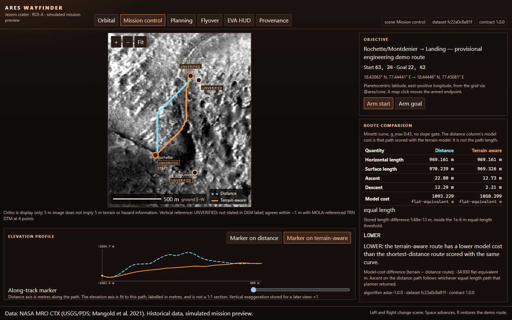

# Checkpoint — 2D Mission Control on real data (2026-11-14, 13:01 local)

Status: **engineering checkpoint, not a scientific sign-off.** G1 is CONDITIONAL; S-4, S2, S6, the
vertical datum and CR-001/CR-002 remain open. Nothing is merged into `main`.

## Repository state

| Ref | SHA | Content |
|---|---|---|
| `main` | `2d255d6` | Revert of the accidental cherry-pick; tree identical to `a4ea78b` (T01) |
| `feat/data-core` | `75f836c` | Data, core, oracle, bundles, ctx_overview |
| `feat/web` | `9609023` | All of data-core + Cursor T07–T08 (`954674e`) + review fixes (`4c1520b`, `9609023`) |
| Tag | `contract-v1.0.0` | Contract unchanged since the tag |

Bundle: ROI-A `fc22a0c8a91f`. Overview: `ctx_overview.jpg` sha256 `8ed01687…28ab0f4`.

## Screenshots (Playwright, 1440×900, `feat/web` @ `9609023`)

- `reference-route.png` — default demo route, taken right after all number assertions passed.
- `mission-control.png` — full page after a second start point (cell 40, 30) was clicked and the hillshade layer was turned on.

## Demo route numbers (Rochette/Montdenier → Landing, Minetti, g_max 0.45, no slope gate)

Shown in the browser and asserted by the e2e test and `web/test/bundle.test.ts`:

| Quantity | Distance route | Terrain-aware route |
|---|---|---|
| Start / goal cell | (63, 24) → (22, 42) | same |
| Horizontal length | 969.161 m | 969.161 m — equal (difference 5.7e-13 m, below the 1e-6 m threshold) |
| Surface length | 970.239 m | 969.326 m |
| Ascent / descent | 22.80 / 12.29 m | 12.73 / 2.21 m |
| Model cost (flat-equivalent m) | 1093.229 | **1058.299** |
| Relation | | **LOWER** by 34.930 flat-equivalent m |

How the screen explains it (binding wording, shown verbatim): "Both routes are the same physical length.
The terrain-aware route has the lowest model cost among them. Model cost is not distance, energy, time or
safety; the curve comes from Earth, unsuited treadmill data (Minetti et al. 2002) and is not validated for
suited Mars EVA." The ascent difference is not headlined: it depends on which equal-length path the distance
planner returns.

## Target verification state

| Point | Role on screen | Coordinates | State |
|---|---|---|---|
| Rochette / Montdenier (Máaz) | Crater-floor igneous sampling target (not a delta target) | 18.43074 N, 77.44437 E | **UNVERIFIED** (S2 open) |
| Octavia E. Butler Landing | Historical Perseverance landing site, hypothetical mission reference point (not a verified habitat) | 18.44463 N, 77.45088 E | **UNVERIFIED** (S2 open) |
| Roubion, Sid | Catalogue points | from `science/pois.json` | **UNVERIFIED** (S2 open) |

Every POI shows an UNVERIFIED badge on the map (4 badges, asserted) and "Coordinates UNVERIFIED (S2)" on
its card. The vertical reference is shown as UNVERIFIED.

## Tests actually run (raw summary, `feat/web` @ `9609023`, 13:01)

| Suite | Command | Result |
|---|---|---|
| Core (coords, A*, Dijkstra, X1 oracle parity, heuristic, compare, bundle integrity) | `pnpm -r test` | 33 / 33 pass |
| Web unit (integrity, overview hash, demo numbers, wording) | `pnpm -r test` | 11 / 11 pass |
| Pipeline | `uv run pytest -q` | 5 / 5 pass |
| Build (tsc + vite) | `pnpm --filter @ares/web build` | pass (JS 237.9 kB, gzip 75.2 kB) |
| End-to-end (Playwright, own dev server, `reuseExistingServer: false`) | `pnpm exec playwright test` | **2 / 2 pass** (2.7 s) |

E2E test 1 — "loads the CTX map and replans from a second start cell": no integrity error; ortho visible;
both lengths 969.161 m; costs 1093.229 / 1058.299; relation LOWER; "equal length"; binding wording; start
(63, 24), goal (22, 42); 4 UNVERIFIED badges; S2 line; 500 m scale bar; footer credit; then a map click on
cell (40, 30) → both routes re-plan (start cell, lengths and plan counter change, no outside-grid message);
hillshade toggle on; badges still 4; none of the forbidden words (safe, safest, EVA-certified, ETA, minutes,
oxygen, energy saved, obstacle-free, NASA-approved) anywhere on the page.

E2E test 2 — "a corrupted DEM byte blocks the map": one byte of `dem.f32.bin` flipped in transit →
"DATASET INTEGRITY" heading naming `dem.f32.bin`; no map, no numbers.

Also checked by hand in the built-in browser: same numbers; the Orbital scene shows the CTX overview with the
ROI-A box in the right place, MRO / CTX labelling, product ID, citation, and "not MOLA, not a live view".

## Review

Cursor's T07–T08 met all four handoff acceptance criteria. Four review findings (one misleading
"Why this route?" sentence, e2e reusing a stranger server, duplicated length checks, untracked `.cursor/`)
were all fixed in `4c1520b` and `9609023` and re-verified.

## Not done / open

- Scientific: G1/S-4 (DEM↔ortho registration quantitatively unverified), S2 (POI coordinates), S6 (Minetti
  coefficients), vertical datum, CR-001/CR-002 decision.
- Engineering: narrow-screen layout and the fully offline `vite preview` run (T13); FLYOVER and EVA_HUD
  are "Available after G2" placeholders.
- Merge into `main`: not done; needs the technical lead's explicit approval.

## Decisions for the technical lead

1. Is the G2 gate (real-data 2D comparison working + tests green) met, so that 3D/HUD work (T09/T11) may start?
2. When to merge `feat/web` into `main` (only after disclosures and browser testing are signed off).
